<!--
  Combined deliverable for Lab 1 (Track A: Linux) and Lab 2 (Track B: xv6).
  Both labs are reported here as a single report.md.
  Note: Lab 2 additionally requires user/sleep.c to be submitted on its
  own inside the xv6 tree — its source is reproduced here for the record,
  but the actual file must also be pushed as user/sleep.c.
  Screenshots referenced below live in reports/evidence/L1/ and
  reports/evidence/L2/.
-->

# Operating Systems — Lab 1 & Lab 2 Report

| Field | Value |
|---|---|
| **Name** | Igor |
| **Surname** | Tacu |
| **Group** | FAF-242 |
| **Labs** | Lab 1 — The OS as a Resource Manager · Lab 2 — Meet the OS You Will Build |
| **Tracks** | Track A: the real OS, from the outside (Linux) · Track B: build your own small OS (xv6) |
| **Date** | 2026-09-28 |

---

## Overview

Lab 1 had me poke at a real Linux VM from the outside, watching how the OS handles files, processes, memory, and devices through ordinary commands. Lab 2 went the other way: I built a small teaching OS (xv6) from source, booted it, used it as a tiny Unix, read through its kernel/user split, and wrote my own program for it. Seeing both sides back to back made the "OS as resource manager" idea from the lecture click in a way that just reading about it wouldn't have.

---

# Part I — Lab 1: The OS as a Resource Manager (Track A, Linux)

## 1. Files and directories (File management)

### What I did

I worked inside `/os-lab1` as `root` on the VM (`ubuntu-4gb-hel1-1`). Started by just looking around: `pwd`, `ls`, `ls -la /` to see what's at the top of the tree, then `ls -la ~` for my home directory and `cd /etc && ls | head` to peek into `/etc`. After that I made a `demo` folder and put a test file through create, copy, rename, remove, then checked and changed its permission bits with `chmod`.

### Commands

```bash
pwd
ls -la /
ls -la ~
cd /etc/ && ls | head

mkdir demo && cd demo
echo "Hello Operating System" > note.txt
cp note.txt copy.txt
mv copy.txt renamed.txt
ls -l
rm renamed.txt
ls -l note.txt
chmod 600 note.txt
ls -l note.txt
chmod 644 note.txt
ls -l note.txt
```

### Evidence

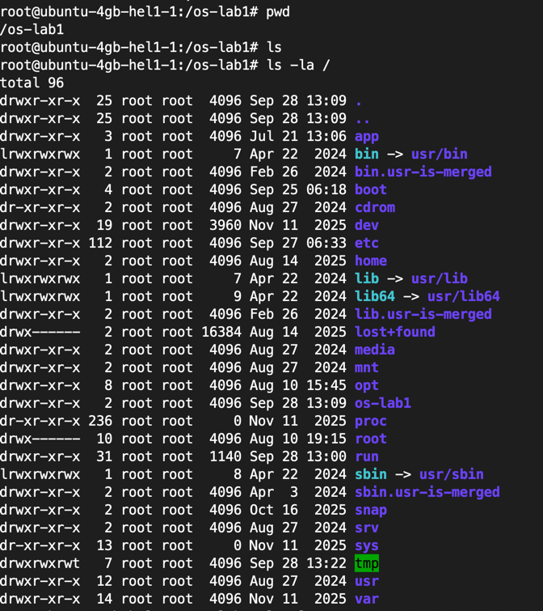
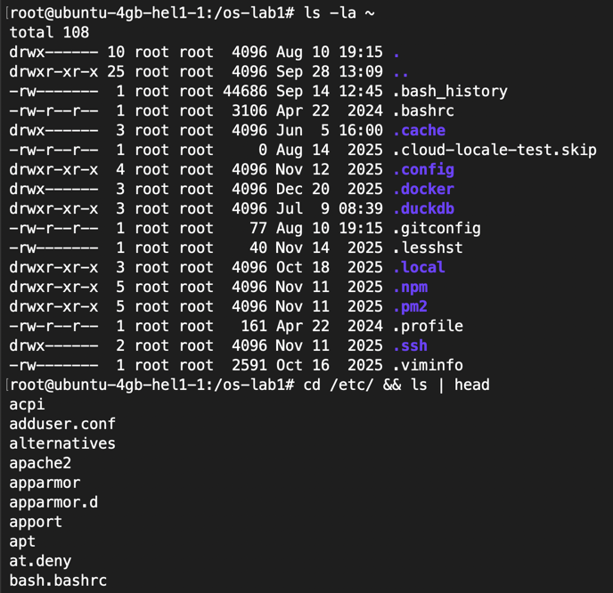
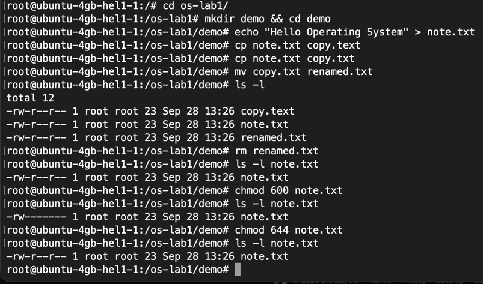

### Observations

1. **Who owns the files you just created, and which group?**
   `root:root`. I was logged in and working as the `root` user, so every file I created (`note.txt`, `copy.text`, `renamed.txt`) is owned by user `root` and group `root`, as shown in the `ls -l` owner/group columns.
2. **What do the ten characters at the start of `ls -l` mean for `note.txt` after `chmod 600`?**
   `-rw-------`: the first `-` marks it as a regular file; the next three (`rw-`) are the owner's permissions (read + write, no execute); the next three (`---`) are the group's permissions (none); the last three (`---`) are everyone else's permissions (none). So only `root` can read or write the file, not even users in the `root` group.
3. **Name two directories directly under `/` and say, in one line each, what they hold.**
   `/etc` holds system-wide configuration files (e.g. `adduser.conf`, `apt`, `bash.bashrc`). `/root` is the home directory of the root user, where my shell's dotfiles (`.bashrc`, `.ssh`, `.profile`, etc.) live.

---

## 2. Processes (Process management)

### What I did

I listed the running processes with `ps aux | head` and counted them with `ps aux | wc -l`, then opened `top` to watch CPU and memory usage live. Next I put `sleep 300` in the background, found it again with `jobs` and `ps -ef | grep sleep`, and killed it by PID. After that I launched another background `sleep`, looked at everything the kernel exposes about it under `/proc/$PID/`, and read its `status` file before killing it too.

### Commands

```bash
ps aux | head
ps aux | wc -l
top

sleep 300 &
jobs
ps -ef | grep sleep
kill <PID>

sleep 300 &
PID=$!
ls /proc/$PID
cat /proc/$PID/status | head -20
kill $PID
```

### Evidence

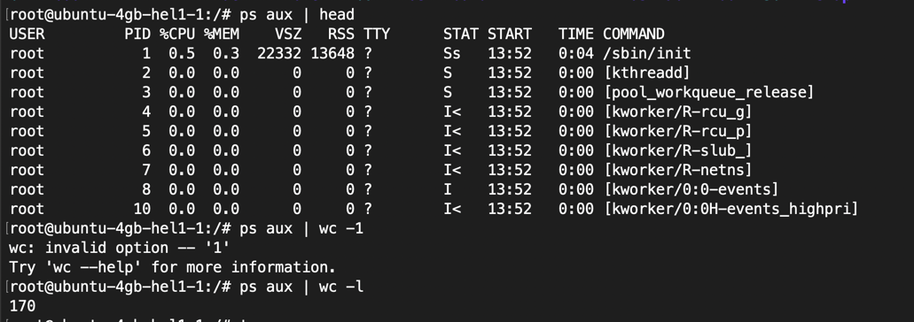
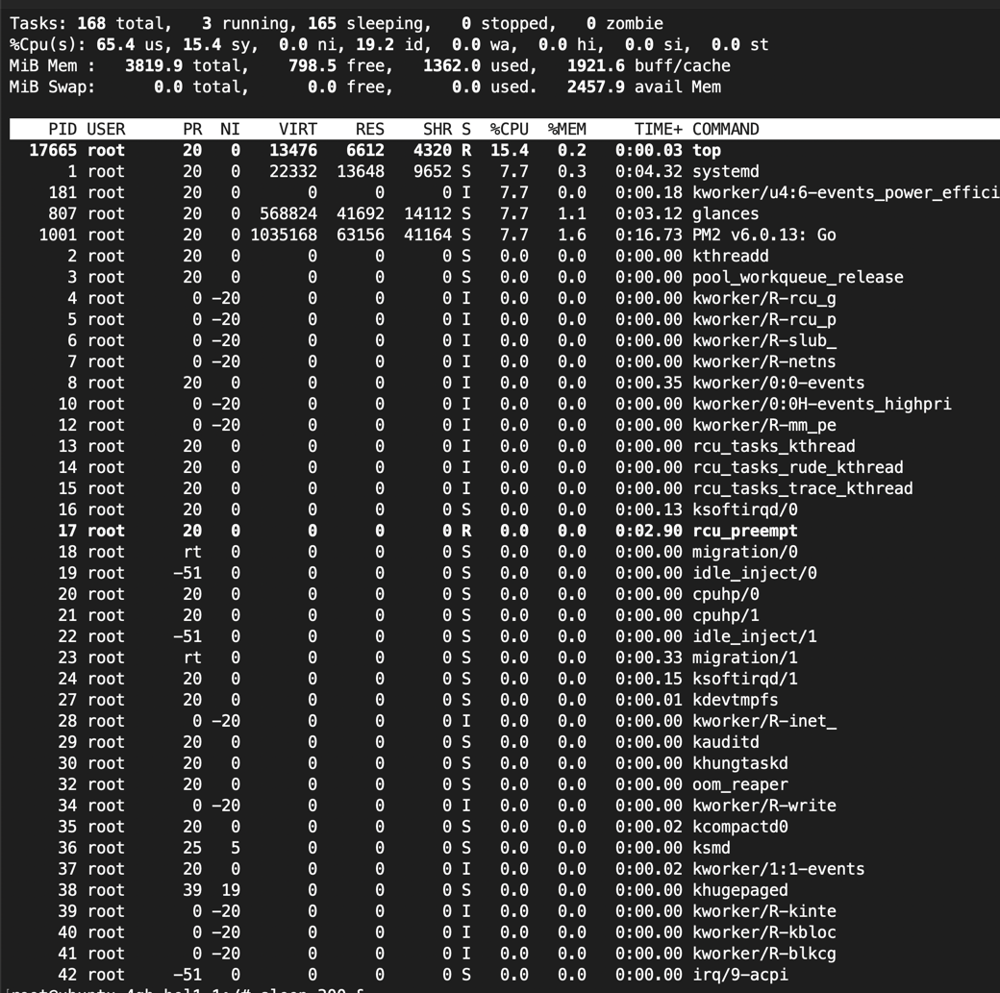
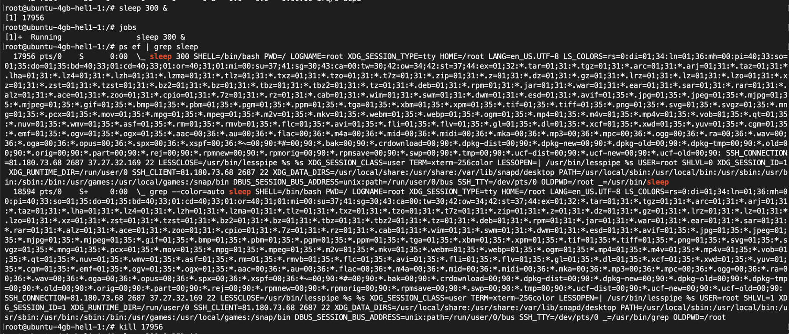
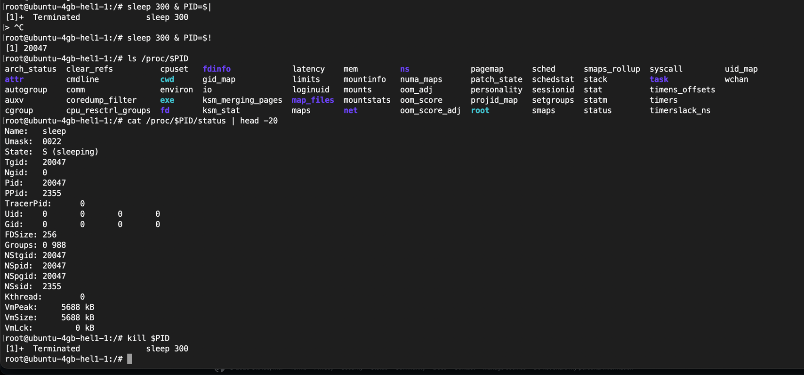

### Observations

1. **What is the PID of process number 1, and what is it (look it up)?**
   PID 1 is `/sbin/init`, the first process the kernel starts at boot, which then spawns and supervises (reaps) every other process on the system.
2. **Roughly how many processes were running on your idle VM?**
   About 170 processes/threads according to `ps aux | wc -l` (168 tasks reported by `top`, of which 3 running and 165 sleeping).
3. **From `/proc/<pid>/status`, what does the "State:" line say for your sleeping process?**
   `State: S (sleeping)`. The process is blocked waiting on an event (here, the `sleep` timer) and isn't consuming CPU while it waits.

---

## 3. Memory (Memory management)

### What I did

I checked the overall RAM/swap totals with `free -h` and `/proc/meminfo`, then started one more background `sleep 300`, grabbed its PID, and read the `VmRSS` line from `/proc/$PID/status` to see how much physical RAM a bare `sleep` process actually uses.

### Commands

```bash
free -h
cat /proc/meminfo | head -6

sleep 300 &
PID=$!
grep VmRSS /proc/$PID/status
kill $PID
```

### Evidence

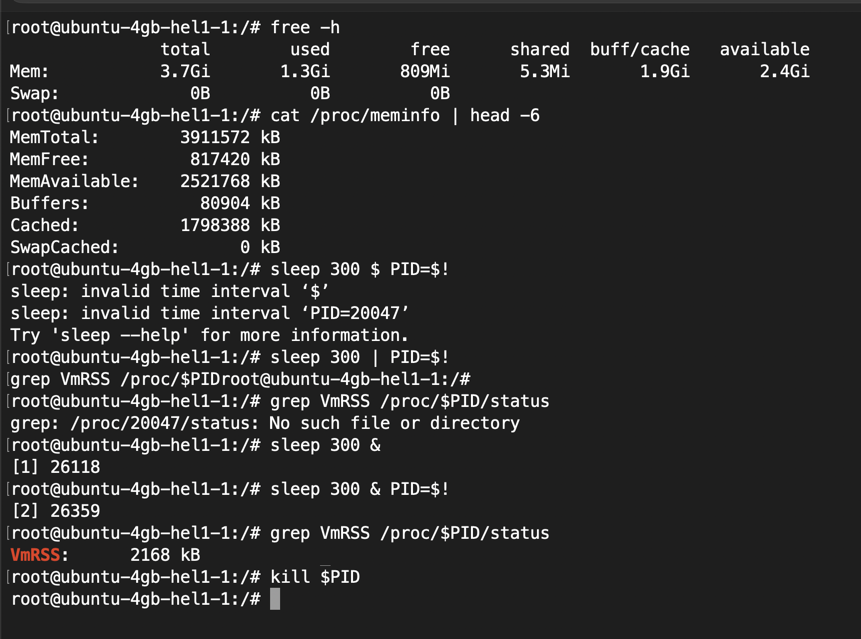

### Observations

1. **How much total RAM does the VM have, and how much is free?**
   The VM has 3.7 GiB (≈3,911,572 kB) of total RAM, with 809 MiB reported as immediately free and ~2.4 GiB "available" once reclaimable buffer/cache is counted.
2. **What is swap, and how much is configured?**
   Swap is disk space the kernel can use as an overflow for RAM when physical memory runs low, swapping out inactive pages. On this VM, swap is `0B`. None is configured, so this instance has no fallback memory beyond physical RAM.
3. **How much resident memory (VmRSS) does a bare `sleep` process use, and does that surprise you?**
   Only about 2168 kB (~2.1 MB). That's small, but not surprising: `sleep` is a tiny statically simple binary that just calls `nanosleep()` and blocks, so it needs almost no working memory beyond its loaded code/stack pages.

---

## 4. Devices and storage (I/O management)

### What I did

I checked the mounted filesystems and free space with `df -h`, looked at the underlying block devices with `lsblk`, measured my lab folder's size with `du -sh`, listed device files under `/dev`, and sampled the live mount table with `mount | head`.

### Commands

```bash
df -h
lsblk
du -sh ~/os-lab1
ls -l /dev | head
mount | head
```

### Evidence

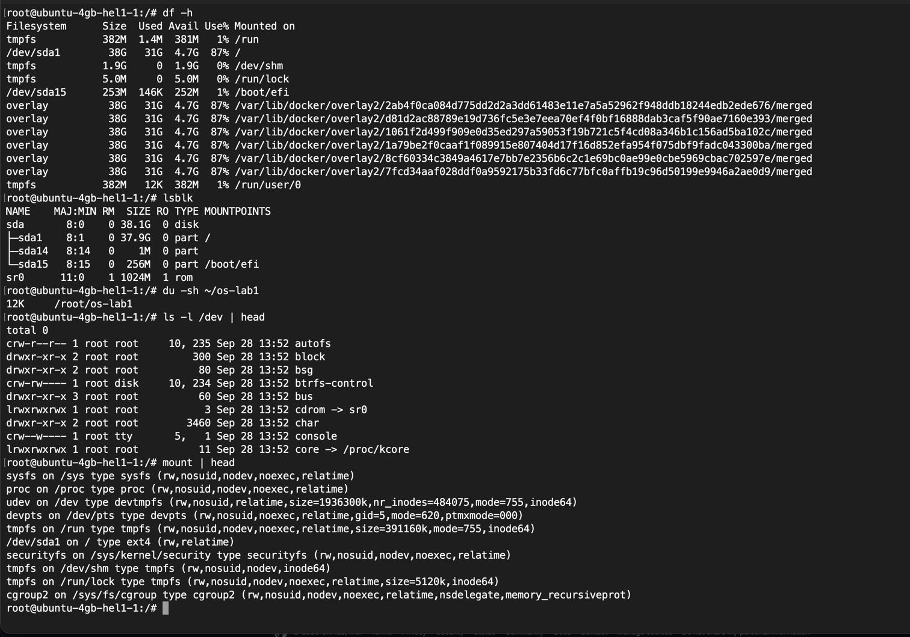

### Observations

1. **Which device is your root filesystem "/" mounted on?**
   `/dev/sda1`, an `ext4` partition (37.9 GiB), as shown by both `df -h` (`/dev/sda1 ... / `) and `lsblk` and confirmed by `mount` (`/dev/sda1 on / type ext4`).
2. **Give one entry from `/dev` and say what real thing it stands for.**
   `/dev/console` is a character device (`crw--w----`, major 5, minor 1) representing the system console, the device the kernel writes boot/system messages to and that early init treats as "the terminal."
3. **In one sentence: what does "everything is a file" mean, based on what you saw?**
   It means the kernel exposes hardware and system objects (disks like `/dev/sda1`, the optical drive via `/dev/cdrom` as a symlink to `sr0`, the console, even kernel memory through `/dev/core` linking to `/proc/kcore`) as ordinary-looking file paths under `/dev`, so the same tools (`ls`, `cat`, permissions, `read`/`write`) that work on a text file also work on a physical device.

---

## Lab 1 — Wrap-up / Synthesis

Each part of this lab put one of the OS's four core resources in front of me. Files: the kernel presents disk storage as a tree of named, owned, permissioned files, and I could explore and edit that with `ls -l`, `chmod`, `cp`/`mv`/`rm`. Processes: every running program is something the OS created, schedules, and can kill, which `ps aux` and `kill` made visible. Memory: the OS splits physical RAM between all processes and keeps track of each one's footprint, which showed up through `free -h` and the `VmRSS` line in `/proc/<pid>/status`. Devices and I/O: disks, terminals, and other hardware all sit behind the same file-like interface under `/dev`, which `lsblk` and `ls -l /dev` made concrete.

---

# Part II — Lab 2: Meet the OS You Will Build (Track B, xv6)

## 1. Build it and boot it

### What I did

I cloned xv6 into `~/xv6-riscv` and ran `make qemu`. The first attempt failed immediately: `Couldn't find a riscv64 version of GCC/binutils`, and `qemu-system-riscv64: not found`. My VM didn't have the RISC-V cross-toolchain or QEMU installed at all, so `make` fell back to the system's regular gcc and tried to pass it `-march=rv64gc`, which isn't a valid flag for x86 gcc. I installed the missing pieces:

```bash
sudo apt update
sudo apt install -y git build-essential gdb-multiarch qemu-system-misc gcc-riscv64-linux-gnu binutils-riscv64-linux-gnu
```

then ran `make clean` to throw out the object files that had been built with the wrong compiler, and `make qemu` again. This time it compiled cleanly through the whole kernel and dropped me into the xv6 shell.

### Commands

```bash
cd ~/xv6-riscv 2>/dev/null || git clone https://github.com/mit-pdos/xv6-riscv ~/xv6-riscv
cd ~/xv6-riscv
ls
make qemu
```

### Evidence

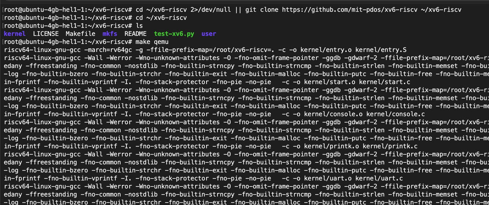
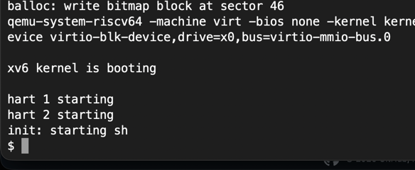

---

## 2. Use xv6 as the Unix it is

### What I did

At the `$` prompt I ran `ls` to see what programs xv6 ships with, `cat README` to read its own description of itself, `echo hello xv6` to check the basics, `ls | grep c` to confirm pipes work, and `wc README` to count lines/words/characters in the readme.

### Commands

```
ls
cat README
echo hello xv6
ls | grep c
wc README
```

### Evidence

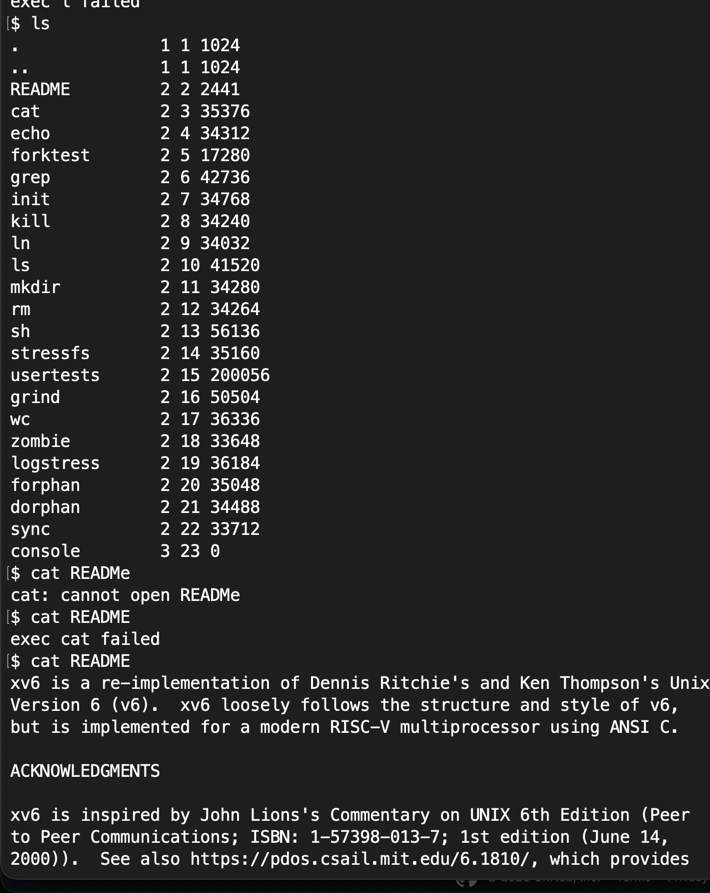
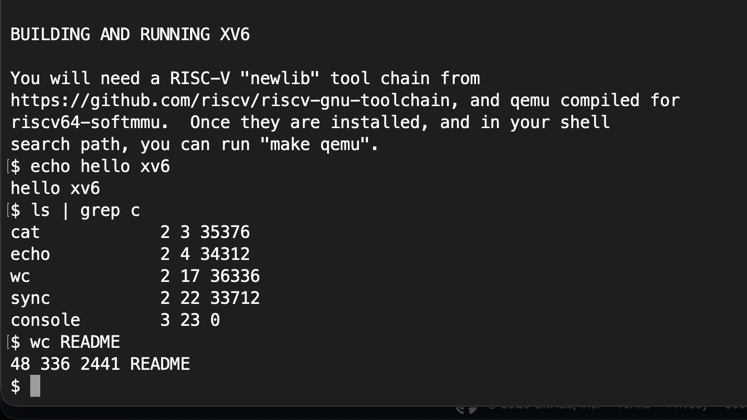

### Observations

1. **List three programs xv6 ships with.**
   From the `ls` output: `cat`, `echo`, `ls` itself, plus others like `grep`, `wc`, `sh`, `init`, `kill`, `mkdir`, `rm`, `usertests`.
2. **You just used a pipe (`|`) inside xv6. Which two OS features must exist for a pipe to work?**
   Processes and inter-process communication. `ls | grep c` needs two separate processes running at once (the OS's process management), and a channel connecting one process's stdout to the other's stdin (the OS's pipe/IPC mechanism) so data can flow between them without a file on disk.
3. **In one sentence: how does the xv6 shell compare to the Linux shell from Lab 1?**
   It's the same idea stripped down to the essentials: xv6's `sh` handles commands, pipes, and redirection just like bash does, just without bash's scripting features, job control, or the hundreds of built-ins Linux accumulated over the decades.

---

## 3. Read the source

### What I did

I exited QEMU (`Ctrl-A`, then `X`) and read through `user/ls.c` and `user/cat.c` with `sed`. Then I opened `user/user.h`, which lists every system call a user program is allowed to make, and grepped `kernel/sysfile.c` for `sys_read`/`sys_write` to see where those calls are actually implemented on the kernel side.

### Commands

```bash
sed -n "1,40p" user/ls.c
sed -n "1,30p" user/cat.c
cat user/user.h
grep -n "sys_read\|sys_write" kernel/sysfile.c | head
```

### Evidence

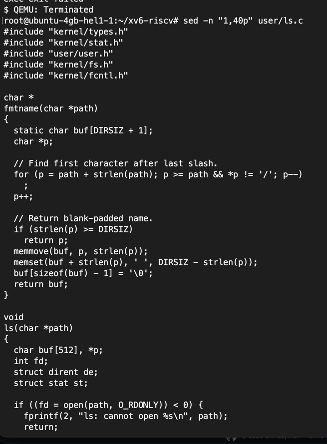
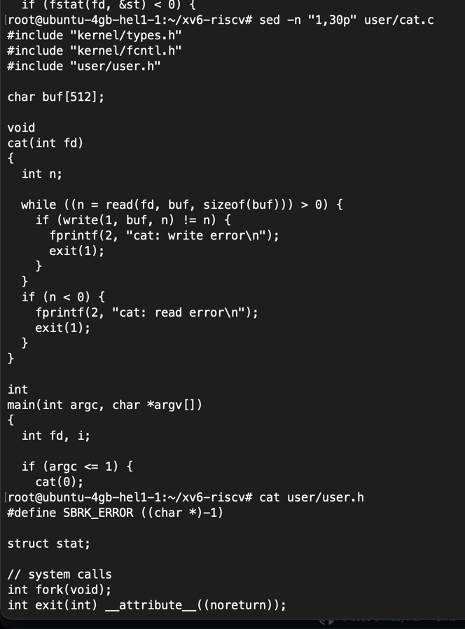
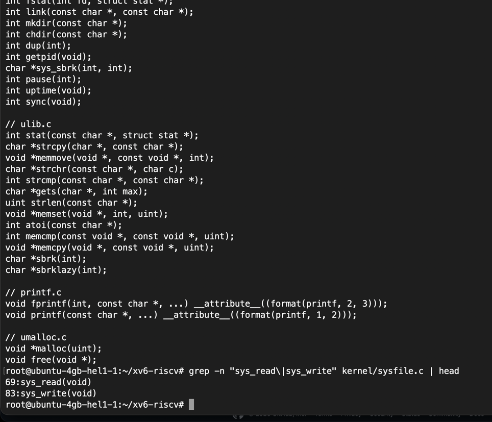

### Observations

1. **Which system calls does `user/cat.c` use, and what does each one ask the kernel to do?**
   `read()` and `write()`. `read(fd, buf, sizeof(buf))` asks the kernel to pull bytes from a file descriptor into a buffer, and `write(1, buf, n)` asks it to push bytes from that buffer out to file descriptor 1 (standard output). `cat` itself is just a loop that keeps calling `read` then `write` until there's nothing left to read.
2. **In which kernel file, and on which line, is `sys_read` implemented?**
   `kernel/sysfile.c`, line 69 (`sys_write` sits right below it, at line 83).
3. **In one sentence: what is the difference between the code in `kernel/` and the code in `user/`?**
   Code in `kernel/` runs privileged and can touch hardware and other processes directly, while code in `user/` runs unprivileged and can only ask the kernel to do things on its behalf, through system calls like the ones declared in `user.h`.

---

## 4. Write my first xv6 program (`user/sleep.c`)

### What I did

I wrote `user/sleep.c` following the classic xv6 pattern: check `argc`, print a usage message and exit(1) if it's wrong, otherwise call the sleep syscall and exit(0). My first draft called `sleep(atoi(argv[1]))`, the way the lab sheet shows it.

Adding it to the build wasn't quite as smooth as expected. First I added `$U/_sleep\` to the `UPROGS` list in the Makefile, but on the first rebuild the binary still wasn't there and running `sleep 10` inside xv6 gave `exec sleep failed`. Turned out my Makefile edit hadn't actually landed, so I redid it more carefully and confirmed with `grep -A 30 "UPROGS=" Makefile` that `$U/_sleep\` was really in the list this time.

That fixed the "not found" problem, but then the build itself broke: `gcc` reported `implicit declaration of function 'sleep'`. I checked `user/user.h` and `user/usys.pl`, the two files that together expose a syscall to user programs, and neither one mentioned `sleep` at all. Checking the kernel side (`kernel/syscall.h`, `kernel/syscall.c`) showed why: this particular xv6 tree doesn't have a syscall called `sleep`. It has one called `pause` (`SYS_pause`, `sys_pause`) that does exactly what the classic `sleep` syscall does, just under a different name. So I changed the call in my program from `sleep(atoi(argv[1]))` to `pause(atoi(argv[1]))`, keeping the file named `sleep.c` and the usage message unchanged since the lab only cares about the program's behavior, not the syscall's internal name. After that, `make qemu` built clean and both test cases worked.

### `user/sleep.c`

```c
#include "kernel/types.h"
#include "user/user.h"

int
main(int argc, char *argv[])
{
  if(argc != 2){
    fprintf(2, "usage: sleep <ticks>\n");
    exit(1);
  }
  pause(atoi(argv[1])); // system call into the kernel (this xv6 tree renamed the classic "sleep" syscall to "pause")
  exit(0);
}
```

### Commands

```bash
make qemu
sleep 10
sleep
```

### Evidence

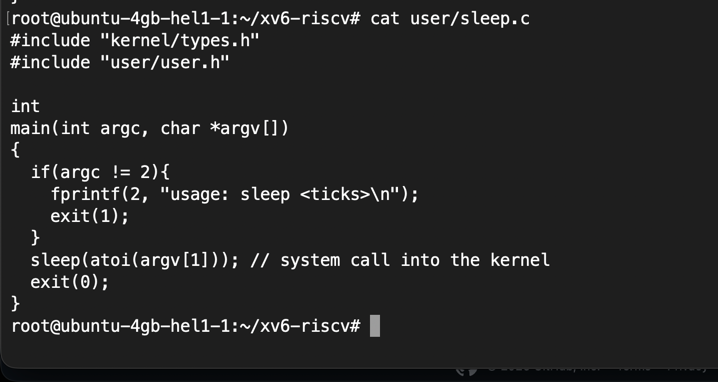
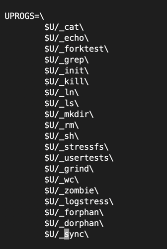
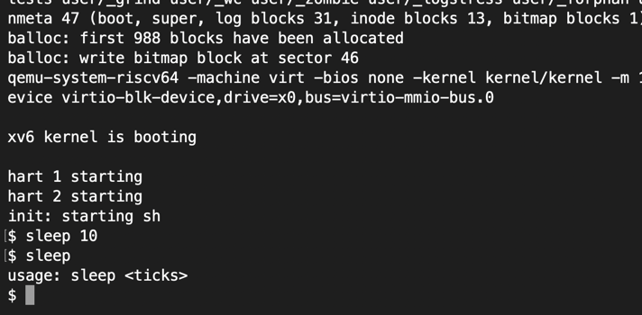

---

## Lab 2 — Wrap-up / Synthesis

By the end of this lab I had xv6 built and booted from source, used it as a small Unix, and read both halves of it: the user programs that ask for things, and the kernel code that grants them. Writing `sleep.c` made that split concrete, since getting it working meant tracing a syscall from my program, through `user.h`, into the kernel's syscall table, and finding out its name had changed along the way. Small tree, but I could hold the whole path in my head while debugging it, which is exactly the point of using xv6 for this.

---

# Overall closing thoughts

Lab 1 and Lab 2 felt like two ends of the same rope. In Lab 1 I could only watch Linux from the outside, through `ps`, `/proc`, `ls -l /dev`, and infer what the kernel must be doing behind those interfaces. In Lab 2 I got to see the other side directly: the actual C code that implements a syscall, and what happens when a user program's idea of that syscall doesn't match the kernel's. The `pause`/`sleep` mismatch in Lab 2 was a good example of something Lab 1 could only hint at: processes ask the kernel for things by name and number, and if the two sides disagree on either, nothing works, no matter how correct your own code looks in isolation.

---

## Deliverables checklist

- [ ] `report.md` (this file) pushed to the course repository, covering both labs
- [ ] `user/sleep.c` pushed separately inside the xv6 tree (Lab 2 requirement). Source is ready at `xv6/user/sleep.c` in this repo, still needs pushing on the VM's actual xv6 tree
- [x] All Lab 1 "Observe" questions answered for all 4 parts
- [x] All Lab 2 "Observe" questions answered (Part 2 and Part 3)
- [x] Evidence attached for every part of Lab 1 (9 screenshots)
- [x] Evidence attached for every part of Lab 2 (10 screenshots)
- [x] Lab 1 closing synthesis written
- [x] Lab 2 closing synthesis written
- [x] Overall closing thoughts written
