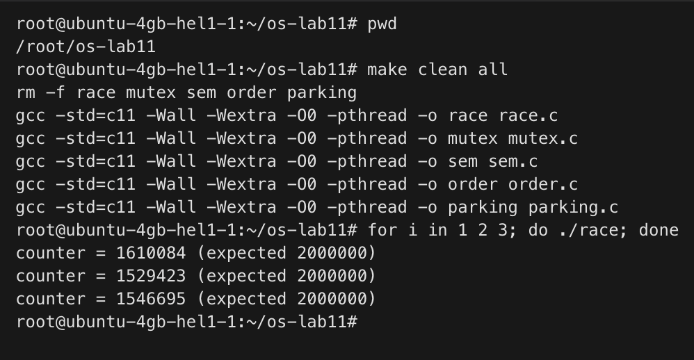
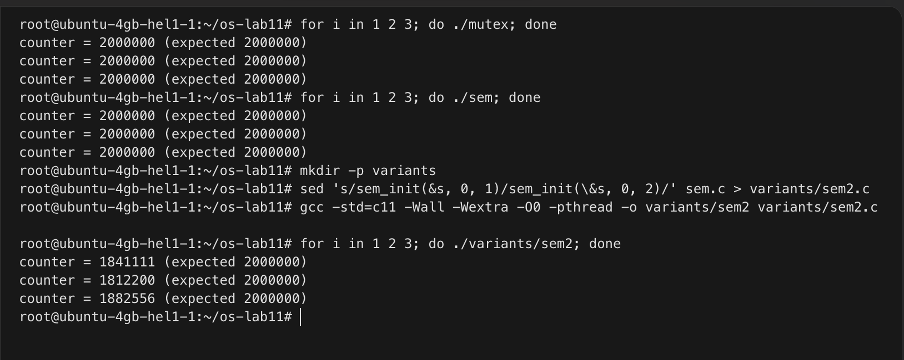
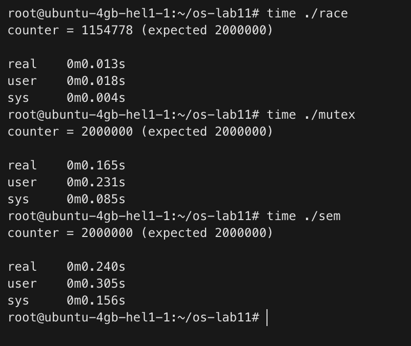
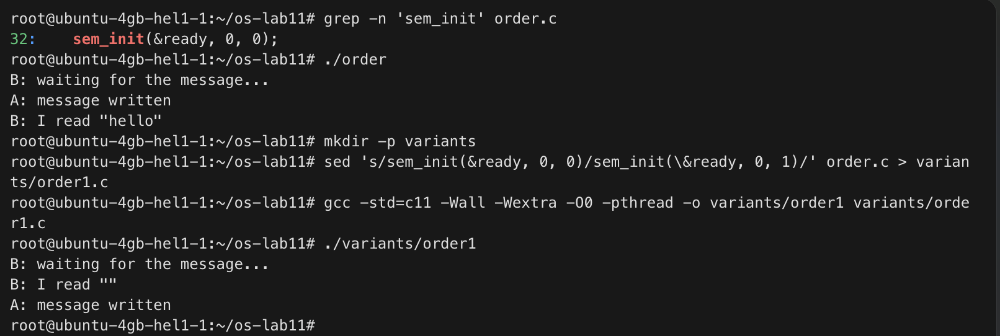
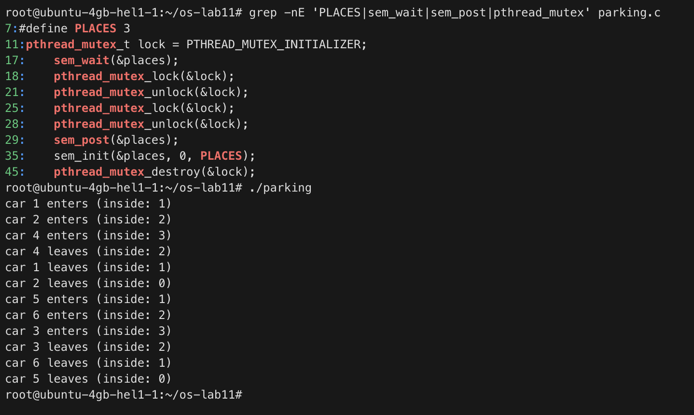

# Lab 11 — The Race and the Semaphore (Linux)

Tacu Igor · FAF-242 · Operating Systems · 2026

## Environment and method

The programs follow the five experiments in the Lab 11 handout. They were compiled and executed on the Ubuntu server on 14 November 2026 with GCC 13.3.0, Linux 6.8.0-142-generic, x86_64. The build uses `-std=c11 -Wall -Wextra -O0 -pthread`. No optimization is enabled. The full command trace, output and source checksums are in [execution.txt](evidence/execution.txt).

The source programs preserve the handout's experiments. Unused thread arguments are marked explicitly; parking passes addresses of stable per-car IDs instead of converting integers to pointers. Like the handout, these small examples assume successful thread creation and synchronization initialization. Deliberately incorrect variants are built separately under `variants/`; the submitted versions retain their correct initial values.

## Part 1 — Observe the race

Source: [race.c](race.c).

```c
for (int i = 0; i < N; i++) {
    counter++;
}
```

Three consecutive runs produced:

| Run | Observed counter | Expected | Lost increments |
| --- | ---: | ---: | ---: |
| 1 | 1,530,534 | 2,000,000 | 469,466 |
| 2 | 1,543,203 | 2,000,000 | 456,797 |
| 3 | 1,343,612 | 2,000,000 | 656,388 |

**1. The three steps.** Conceptually, the processor reads the shared value into a register, adds one to the register, and stores the result back to memory. This is a read–modify–write operation; the C expression does not make it atomic.

**2. How an addition is lost.** If the value is 10, A can read 10, B can read 10, A can calculate and store 11, and B can calculate and store 11. Both threads executed their increment, but the shared value increased only once.

**3. Why runs differ.** The scheduler and the timing of memory accesses change the interleaving. Different overlaps overwrite different amounts of work. These three runs demonstrate the failure; a particular run could also happen to reach the expected value. More precisely, unsynchronized concurrent accesses constitute a data race and have undefined behavior in C. `-O0` helps expose the teaching example; it does not make that program correct.

### Native Terminal evidence — compilation and race



The subsequent screenshot run produced 1,610,084; 1,529,423; and 1,546,695, respectively. These lost 389,916; 470,577; and 453,305 increments relative to 2,000,000. The image also shows all five programs compiling with `-O0 -pthread` and no compiler diagnostics. These are separate runs from the initial command trace above; their different values illustrate the variable interleaving.

## Part 2 — Protect the critical section

Sources: [mutex.c](mutex.c), [sem.c](sem.c).

```c
pthread_mutex_lock(&lock);
counter++;
pthread_mutex_unlock(&lock);
```

```c
/* sem_init(&s, 0, 1) before creating the threads */
sem_wait(&s);
counter++;
sem_post(&s);
```

**1. Three runs each.** Both programs printed `counter = 2000000 (expected 2000000)` in all three runs. The mutex admits one thread to the critical section. The semaphore initialized to 1 supplies one permit, so it also admits only one thread at a time when waits and posts are paired correctly.

**2. Initialize the semaphore to 2.** A separately compiled `variants/sem2.c` produced 1,893,244; 1,871,080; and 1,900,513. Two permits allow both threads into the critical section together. Individual semaphore operations remain synchronized, but the shared increment is no longer protected by mutual exclusion. A counting semaphore is also different from a mutex in ownership: a semaphore can be posted by a different thread.

**3. Cost of locking.** A timed run recorded these elapsed times:

| Program | Counter | Real time |
| --- | ---: | ---: |
| race | 1,108,963 | 0.01 s |
| mutex | 2,000,000 | 0.17 s |
| sem | 2,000,000 | 0.21 s |

The correct programs perform synchronization for every increment. They serialize updates and pay the cost of acquiring and releasing the lock or permit, contention, and possible blocking. The fast race program did not produce a valid result. These are single-run measurements on this server, not universal timing guarantees or a reliable benchmark ranking of mutexes versus semaphores.

### Native Terminal evidence — mutual exclusion and two permits



In this subsequent capture, all six protected runs returned 2,000,000. The separate two-permit variant returned 1,841,111; 1,812,200; and 1,882,556. Two permits let both threads update the shared counter concurrently, so the semaphore no longer provides mutual exclusion for this critical section. The capture shows the variant being generated and compiled without changing the submitted `sem.c`.

### Native Terminal evidence — execution times



This subsequent interactive Bash `time` measurement recorded:

| Program | Counter | Real | User | System |
| --- | ---: | ---: | ---: | ---: |
| race | 1,154,778 | 0.013 s | 0.018 s | 0.004 s |
| mutex | 2,000,000 | 0.165 s | 0.231 s | 0.085 s |
| sem | 2,000,000 | 0.240 s | 0.305 s | 0.156 s |

The protected programs performed all increments correctly. The faster unprotected run lost 845,222 increments. `real` measures elapsed time; `user` and `sys` measure CPU time spent in user mode and kernel mode. Their sum can exceed elapsed time because the threads can execute on different CPUs. These measurements are distinct from the earlier scripted timing run.

## Part 3 — Signal that the message is ready

Source: [order.c](order.c).

```c
/* Initial state: sem_init(&ready, 0, 0). */
/* Writer: */
strcpy(message, "hello");
printf("A: message written\n");
sem_post(&ready);
/* Reader: */
sem_wait(&ready);
printf("B: I read \"%s\"\n", message);
```

With initial value 0, the observed output was:

```text
B: waiting for the message...
A: message written
B: I read "hello"
```

**1. Change the initial value to 1.** The separate `variants/order1` run printed:

```text
B: waiting for the message...
B: I read ""
A: message written
```

B consumed the initial permit without waiting for A. The global array initially contains zeros, so in this run B printed an empty string while A was still sleeping. Starting the reader first and delaying the writer makes this outcome likely; it is not a synchronization guarantee. Without the intended wait/post ordering, a read can also overlap the write, so the incorrect variant is not a safe way to read the message.

**2. Meaning of zero.** A semaphore initialized to zero represents an event or resource that is not available yet: the reader must wait for a post before proceeding.

The submitted `order.c` keeps the initial value at zero. The guarantee is that the message read happens after its publication; creation order alone does not guarantee that B's first diagnostic line is printed before A's diagnostic line on every possible schedule.

### Native Terminal evidence — readiness signal



The source inspection shows `sem_init(&ready, 0, 0)`. In the correct run, B prints its waiting message, A writes the message, and B reads "hello". The capture then shows the separate one-permit variant being generated, compiled, and run. In that run B reads the empty string before A prints that the message was written. The initial permit lets the reader proceed prematurely; it cannot stand in for the writer's readiness signal. The submitted `order.c` retains the initial value zero.

## Part 4 — Count the available parking places

Source: [parking.c](parking.c).

```c
sem_wait(&places);
pthread_mutex_lock(&lock);
inside++;
printf("car %ld enters (inside: %d)\n", id, inside);
pthread_mutex_unlock(&lock);
/* The car parks, then decrements inside under the mutex. */
sem_post(&places);
```

**1. Largest observed occupancy.** With `PLACES = 3`, the maximum printed occupancy was 3. The `sem_wait(&places)` before entry enforces the capacity: only three permits exist initially, and a car returns its permit only after leaving. The mutex protects the separate `inside` variable and keeps each update together with its printed record. The semaphore and mutex have different jobs.

The [three-place execution](evidence/parking3.txt) contains six entries and six exits, ends at zero, and never exceeds three. A check of the event sequence also verifies that each car enters and leaves exactly once and that every printed count agrees with the sequence.

**2. Set `PLACES` to 1.** The [one-place execution](evidence/parking1.txt) has maximum occupancy 1: cars enter and leave one at a time. The semaphore now acts as a binary gate for parking access. It does not guarantee that cars enter in ID order or provide the ownership semantics of a mutex.

### Native Terminal evidence — three parking places



The capture shows `PLACES` set to 3 and the wait/post operations surrounding parking access. Cars 1, 2 and 4 enter first; after they leave, cars 5, 6 and 3 enter. Each car enters and leaves exactly once. The printed occupancy remains between zero and three and finishes at zero. The different car order from the earlier saved run reflects thread scheduling; admission in car-ID order is not required.

## Reproduce and inspect the evidence

Run `make` to build the five programs, or `bash run-experiments.sh` to repeat all required experiments, including the separate incorrect variants and timing measurements. The script replaces its own evidence files when rerun; retain a copy first if comparing runs.

[Terminal capture commands](CAPTURES.md) split the experiments into readable screenshot-sized blocks. The committed text evidence is the actual execution trace. Native Terminal screenshots are embedded with captions as they are captured; no generated terminal panels are used as screenshots.
