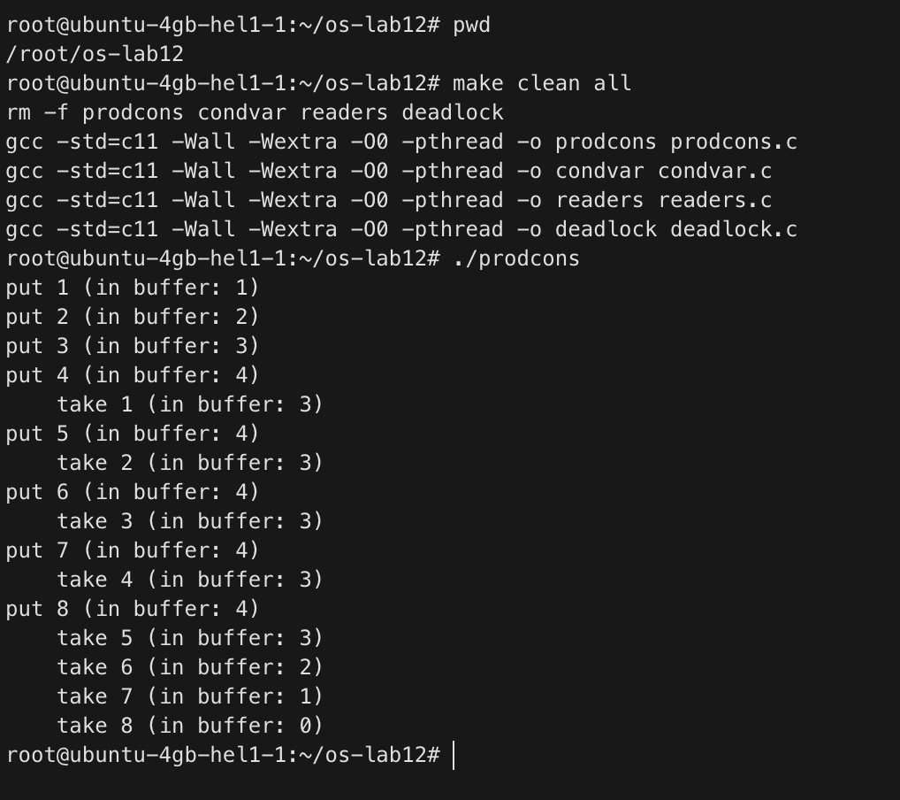
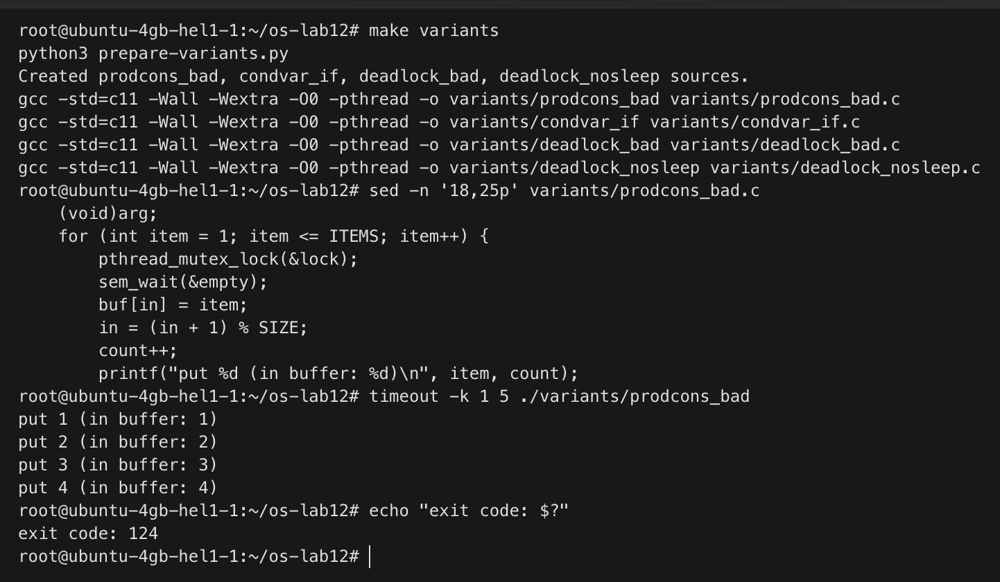
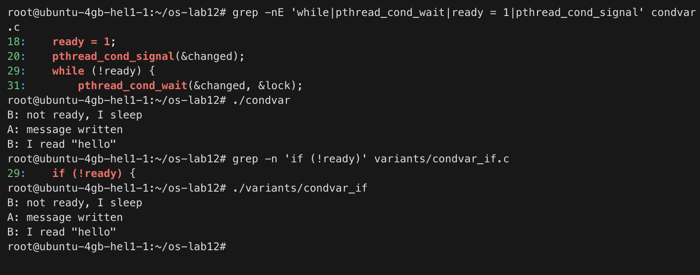
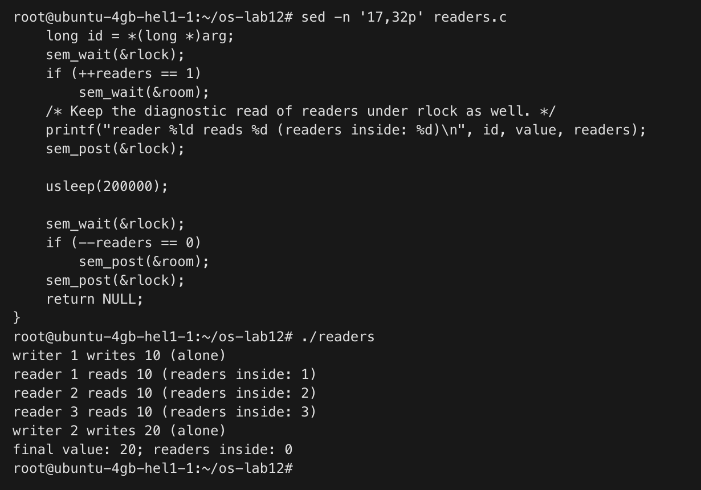

# Lab 12 — Producer, Consumer and the Other Tools

Tacu Igor · FAF-242 · Operating Systems · 2026

## Environment and execution record

The four experiments were compiled and run on the Ubuntu server on 16 November 2026: Linux 6.8.0-142-generic, x86_64, GCC 13.3.0. The Makefile uses `-std=c11 -Wall -Wextra -O0 -pthread`. All four submitted programs and the four experimental variants compiled without diagnostics. The actual commands, outputs, exit codes and source checksums are retained in [execution.txt](evidence/execution.txt); [results.json](evidence/results.json) records the checked results.

The programs follow the Lab 12 handout. Unused thread arguments are marked, thread IDs use stable per-thread storage, and synchronization objects are destroyed after joins. `_DEFAULT_SOURCE` exposes `usleep` with the selected C dialect on glibc. Output is line-buffered in the two programs deliberately used for timeout experiments, so the record retains their diagnostic lines. These teaching examples assume successful thread creation and synchronization initialization, as in the handout.

Two details were corrected: `readers.c` prints the shared reader count while holding `rlock`, and the fixed `deadlock.c` describes the actual A-then-B lock order in its messages. The original incorrect variants are generated separately by [prepare-variants.py](prepare-variants.py); they do not overwrite the submitted programs.

## Part 1 — Producer and consumer

Source: [prodcons.c](prodcons.c). The circular buffer has four slots and transfers items 1 through 8. `empty` starts at 4, `full` starts at 0, and the mutex protects the buffer, indices and diagnostic count.

```c
sem_wait(&empty);
pthread_mutex_lock(&lock);
buf[in] = item;
in = (in + 1) % SIZE;
count++;
printf("put %d (in buffer: %d)\n", item, count);
pthread_mutex_unlock(&lock);
sem_post(&full);
```

The saved run reached occupancy 4, consumed all eight items in order, and finished at zero. The automated check reconstructs the queue from all 16 events. It verifies every printed occupancy against the reconstructed queue, checks the range 0–4, and checks that each item is put and taken once in FIFO order. The complete output is in [prodcons.txt](evidence/prodcons.txt).

**1. Which call stops the producer?** `sem_wait(&empty)` blocks when no free-slot permit remains. A successful wait reserves one slot before the producer touches the buffer. The consumer returns that permit with `sem_post(&empty)` after removing an item. This follows the documented blocking behavior of [sem_wait](https://man7.org/linux/man-pages/man3/sem_wait.3.html).

**2. Who waits initially?** If the consumer runs before any item is published, it waits in `sem_wait(&full)` because `full` is initially zero. The producer initially has four empty-slot permits. Starting the consumer thread first does not guarantee the scheduler will execute it first; it could reach its wait after the producer has already posted an item.

**3. Lock the mutex before waiting for an empty slot.** The separate `variants/prodcons_bad` run printed puts 1–4 and then stopped making progress; `timeout -k 1 5` returned 124. When the buffer is full, the producer can hold the mutex while waiting for `empty`. The consumer needs that mutex to remove an item and post `empty`. Neither can release the resource the other needs:

```text
producer holds lock -> waits for an empty slot
consumer needs lock -> cannot remove an item -> cannot return an empty slot
```

The submitted version retains the correct order: reserve a slot first, then acquire the mutex. A timeout alone is only evidence of non-completion; the source and the full-buffer state explain the deadlock in this experiment.

### Native Terminal evidence — bounded FIFO transfer



The interactive capture shows the working directory `/root/os-lab12` and all four programs compiling with `-std=c11 -Wall -Wextra -O0 -pthread`, without compiler diagnostics. The producer inserts items 1–8, and the consumer removes them in the same order. The printed occupancy reaches four, stays within zero to four throughout the 16 events, and ends at zero after item 8 is consumed. This is a live repeat run, separate from the saved scripted execution.

### Native Terminal evidence — incorrect producer lock order



The source excerpt places `pthread_mutex_lock(&lock)` before `sem_wait(&empty)`. The repeat run prints only puts 1–4, reaching occupancy four, and is terminated by the five-second timeout with exit code 124. No take is printed. Together with the inspected source, this supports the full-buffer deadlock: the producer waits for a free-slot permit while holding the mutex, preventing the consumer from removing an item and returning a permit. The correct submitted `prodcons.c` remains unchanged.

## Part 2 — Condition variable

Source: [condvar.c](condvar.c).

```c
pthread_mutex_lock(&lock);
while (!ready) {
    printf("B: not ready, I sleep\n");
    pthread_cond_wait(&changed, &lock);
}
printf("B: I read \"%s\"\n", message);
pthread_mutex_unlock(&lock);
```

The saved run produced:

```text
B: not ready, I sleep
A: message written
B: I read "hello"
```

**1. What remembers readiness?** The integer `ready`, accessed under the mutex, remembers the state. The condition variable is a notification mechanism, not a stored permit. If A finishes first, B sees `ready == 1` and does not need an earlier signal to have been saved.

**2. Replace `while` with `if`.** The separate `variants/condvar_if` run also printed the three lines above and exited with zero. With one reader, one writer and no observed premature wakeup, this run did not expose the defect. Passing this experiment does not establish that `if` is correct.

**3. Why use `while`?** A condition wait may return after a spurious wakeup even though `ready` is still zero. B must recheck the predicate under the mutex and wait again if necessary. The wait atomically releases the mutex while blocking and reacquires it before returning, allowing A to acquire the mutex and publish the state. These semantics and the need to re-evaluate the predicate are specified in the [POSIX condition-wait documentation](https://man7.org/linux/man-pages/man3/pthread_cond_wait.3p.html). In a more general reusable-resource example, another awakened thread can also consume the resource before a waiter reacquires the mutex.

### Native Terminal evidence — condition wait with while and if



The inspected correct source shows `ready = 1`, `pthread_cond_signal`, and the wait inside `while (!ready)`. Its output shows B sleeping, A writing, and B reading "hello". The separate variant visibly uses `if (!ready)` and produces the same three output lines in this repeat run. No premature wakeup is exposed by this observation, so the successful if run does not establish general correctness. The submitted `condvar.c` retains the while loop to recheck readiness after every return from the wait.

## Part 3 — Readers and writers

Source: [readers.c](readers.c). Three readers may overlap; each of the two writers must exclude both readers and the other writer.

```c
sem_wait(&rlock);
if (++readers == 1)
    sem_wait(&room);
printf("reader %ld reads %d (readers inside: %d)\n", id, value, readers);
sem_post(&rlock);
/* Reading interval. */
sem_wait(&rlock);
if (--readers == 0)
    sem_post(&room);
sem_post(&rlock);
```

In all three recorded runs, writer 1 wrote 10, the readers printed 10 with reader counts 1, 2 and 3, then writer 2 wrote 20. The final state was `final value: 20; readers inside: 0`. The checker verifies the five participant IDs, both increments, the reader-count range and the final state. These output checks support the observed run; they are not an exhaustive proof over thread schedules, and creation order is not a promised execution order.

**1. Which reader operations allow sharing and exclude writers?** The first reader executes `if (++readers == 1) sem_wait(&room)`, and the last departing reader executes `if (--readers == 0) sem_post(&room)`. The group retains the room permit while readers remain. Later readers join that group without each acquiring `room`; writers must acquire it individually.

**2. Why protect `readers` with `rlock`?** Increment, decrement and the first/last tests must be coordinated. Without protection, concurrent updates can be lost, two threads can misidentify the first reader, or the room can be released at the wrong time. The printed access also needs protection: in the handout it appears after releasing `rlock`, where another reader can modify the count concurrently. This version keeps the print inside the counter critical section. The subsequent reading intervals still overlap after `rlock` is released.

**3. What if readers continuously arrive?** This is a reader-preference algorithm. As long as new readers join before the last current reader leaves, the group keeps the room permit and a writer can wait indefinitely: writer starvation. The finite three-reader run does not demonstrate starvation; it illustrates the policy whose limitation becomes relevant with a continuing stream of readers.

### Native Terminal evidence — readers and writers



The inspected source protects the reader counter and its diagnostic print with `rlock`; the first reader acquires `room` and the last releases it. In this repeat run, writer 1 writes 10, readers 1–3 read 10 with printed occupancies 1, 2 and 3, and writer 2 writes 20. The final line is `final value: 20; readers inside: 0`. The reading intervals overlap after readers release `rlock`, while their group retains `room`. This finite execution illustrates the protocol; it does not test starvation under a continuous arrival stream.

## Part 4 — Deadlock and consistent lock order

Submitted source: [deadlock.c](deadlock.c), the fixed version. `variants/deadlock_bad.c` retains opposite lock order for the required failure demonstration.

**1. The wait cycle.** In the recorded incorrect run:

```text
one: I have A, I want B
two: I have B, I want A
exit code: 124
```

The resource-allocation cycle is:

```text
thread one --waits for--> B --held by--> thread two
    ^                                      |
    |                                      |
    +---- A <--waits for--------------------+
          |
          +-- held by thread one
```

Equivalently, one holds A and waits for B, while two holds B and waits for A. Neither reaches its unlock calls. The five-second timeout terminates the demonstration process; it does not repair the deadlock.

Both threads in the fixed version acquire A, then B, and release B, then A:

```c
pthread_mutex_lock(&A);
printf("two: I have A, I want B\n");
sleep(1);
pthread_mutex_lock(&B);
printf("two: I have both\n");
pthread_mutex_unlock(&B);
pthread_mutex_unlock(&A);
```

That recorded run printed both `I have both` messages and `done`, and returned 0 within the same five-second limit. Its diagnostic message was updated along with the code so it no longer incorrectly claims that thread two holds B first.

**2. Remove both sleeps from the original version and run ten times.** On this server, all ten recorded runs of `variants/deadlock_nosleep` reached the opposite-lock diagnostic lines and were terminated with code 124. Each repetition used a one-second timeout, noted explicitly in the log. Removing the sleeps did not avoid deadlock in these measurements. A different schedule can let one thread acquire both mutexes and finish before the other takes its first lock, so completion is possible in other runs. That possibility makes the fault harder to reproduce rather than fixing it; even repeated successful tests would not remove the circular-wait path. The diagnostic output itself can affect scheduling.

**3. Why does the common order prevent this deadlock?** Requiring both threads to acquire A before B eliminates circular wait: a thread waiting for A cannot already hold B in this two-lock protocol. This claim applies to this protocol with distinct mutexes; it does not promise that every possible synchronization error is impossible.

## Reproduction and evidence

Run `make clean all variants` on Linux, then `python3 run-experiments.py` to reproduce the experiments and checks. The runner overwrites its evidence files with the new results. Deliberately incorrect programs are always run with a timeout. The submitted source `deadlock.c` is the fixed version.

[Terminal capture commands](CAPTURES.md) organize the live repetitions into readable blocks. Native screenshots are embedded with captions as they are captured; the current text logs preserve the measured execution.
