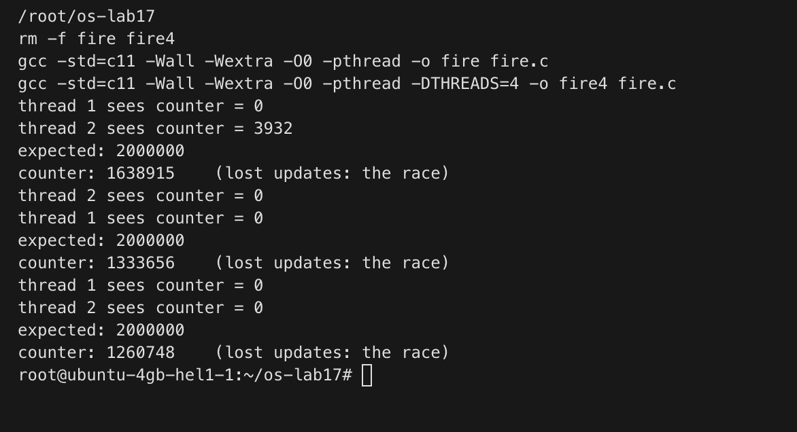

# Lab 17 — Threads share memory and race

Tacu Igor · FAF-242 · Sisteme de operare

## Environment and method

The supplied Lab 17 handout asks for an unprotected shared counter, a four-thread variation, and three Observe answers. The implementation follows that experiment. `fire.c` defaults to two POSIX threads; `make` also compiles the same source as `fire4` with `-DTHREADS=4`. Each worker performs one million increments. Stable ID objects are passed by address, and pthread creation/join errors are checked. The counter is deliberately unprotected, as required.

Real runs were executed on 24 November 2026 on the Ubuntu server: x86-64 Linux 6.8.0-142-generic, glibc 2.39, GCC 13.3.0. Both variants were built with `-std=c11 -Wall -Wextra -O0 -pthread`, without compiler diagnostics. Ten executions of each variant were recorded by `run-experiments.py`. The raw commands and output are in `evidence/execution.txt`; all twenty observations are in `evidence/results.json`.

The implementation and checks were prepared with coding assistance. These are actual automated terminal executions. The supplied native Terminal capture documents compilation and three subsequent two-thread runs. Four-thread and source captures are still pending; `CAPTURES.md` contains their live capture commands.

## Part 1 — One shared counter, two threads

The experimental core is:

```c
long counter = 0;
static void *work(void *arg)
{
    long id = *(long *)arg;
    printf("thread %ld sees counter = %ld\n", id, counter);
    for (int i = 0; i < N; i++)
        counter++;  /* deliberately unprotected */
    return NULL;
}
```

The first recorded execution produced:

```text
$ ./fire
thread 1 sees counter = 0
thread 2 sees counter = 4593
expected: 2000000
counter: 1258330    (lost updates: the race)
```

**Observe 1 — What does the non-zero starting counter show?** Thread 2 read 4,593 from the same global object already modified by thread 1. Both workers belong to one process and access one shared address space; each does not receive a private copy of the global counter. Their automatic variables and call stacks remain separate. This observed read illustrates sharing, but the unprotected access is a data race and is not a valid synchronization protocol or a guarantee of timely visibility in portable C.

**Observe 2 — Why are updates lost and results different?** Conceptually, `counter++` reads the old value, adds one, and writes the result. If both workers read 100, compute 101, and then both write 101, two increments leave only one visible update. Scheduling changes the overlap between these steps, so the measured totals vary. `pthread_join` ensures that main waits for both workers to finish; it does not make their preceding increments mutually exclusive.

The C language gives a data race undefined behavior. Therefore, the handout's “always less than two million” describes its intended demonstration, not a universal bound. A run reaching the expected value would not prove the program correct. `-O0` helps expose the intended read–modify–write experiment; it does not repair it, and `volatile` would not repair it either.

## Native Terminal evidence — build and two-thread race



The supplied capture shows `/root/os-lab17`, compilation of both executables with `-O0 -pthread`, and three two-thread totals: 1,638,915; 1,333,656; and 1,260,748. Relative to 2,000,000, these runs lost 361,085; 666,344; and 739,252 increments. They are subsequent interactive observations, separate from the ten-run series below.

In the first captured run, thread 2 initially reads 3,932 after thread 1 reads zero. In the next two runs, both initial reads are zero, yet the final totals still lose updates. Thus the initial diagnostic may precede the conflicting loop updates; two zero starting reads do not imply separate memory or an absence of a race. Thread 2 prints before thread 1 in the second run, illustrating that creation order does not fix their execution order.

## Part 2 — Four workers and the observed loss

The additional executable changes only the worker count:

```text
gcc -std=c11 -Wall -Wextra -O0 -pthread -o fire fire.c
gcc -std=c11 -Wall -Wextra -O0 -pthread -DTHREADS=4 -o fire4 fire.c
```

Four workers should collectively perform 4,000,000 increments. The first four-worker run ended at 2,721,928, losing 1,278,072 relative to that target. The complete measured series is:

| Run | Two threads: counter | Lost | Four threads: counter | Lost |
| --- | ---: | ---: | ---: | ---: |
| 1 | 1,258,330 | 741,670 | 2,721,928 | 1,278,072 |
| 2 | 1,073,256 | 926,744 | 2,220,999 | 1,779,001 |
| 3 | 1,361,266 | 638,734 | 2,930,129 | 1,069,871 |
| 4 | 1,440,973 | 559,027 | 2,400,952 | 1,599,048 |
| 5 | 1,270,174 | 729,826 | 3,081,305 | 918,695 |
| 6 | 1,277,940 | 722,060 | 2,802,551 | 1,197,449 |
| 7 | 1,093,547 | 906,453 | 2,816,857 | 1,183,143 |
| 8 | 1,090,006 | 909,994 | 1,559,066 | 2,440,934 |
| 9 | 1,614,546 | 385,454 | 1,680,003 | 2,319,997 |
| 10 | 1,626,304 | 373,696 | 1,414,598 | 2,585,402 |

The two-thread mean was 1,310,634.2, corresponding to 689,365.8 missing increments or 34.47% of the target. The four-thread mean was 2,362,838.8, corresponding to 1,637,161.2 missing increments or 40.93%. Both absolute and relative mean loss increased in these ten-run samples. The first four-thread run happened to have a lower relative loss than some two-thread runs; the experiment does not establish monotonic loss for every individual execution or other machines.

**Observe 3 — One-sentence fix.** Make the complete increment a mutually exclusive critical section, for example by having every worker lock the same mutex before `counter++` and unlock it afterwards.

A proposed implementation would surround the increment with:

```c
pthread_mutex_lock(&counter_lock);
counter++;
pthread_mutex_unlock(&counter_lock);
```

The mutex must be initialized before starting workers and shared by all of them. Reads during worker execution also need the same protection if they access a counter being changed. The final read after all joins is already sequenced after worker completion. The handout asks for the fix as a proposal; the submitted `fire` and `fire4` intentionally retain the race for observation.

## Reproduction and native captures

On Linux, run `make clean all`, then `./fire` and `./fire4` repeatedly. To repeat the saved twenty-run procedure, run `python3 run-experiments.py`; it replaces the local evidence files with the newly observed values. Follow `CAPTURES.md` for separate build/two-thread, four-thread and source screenshots. Keep genuine values even when they differ from this recorded sample.
