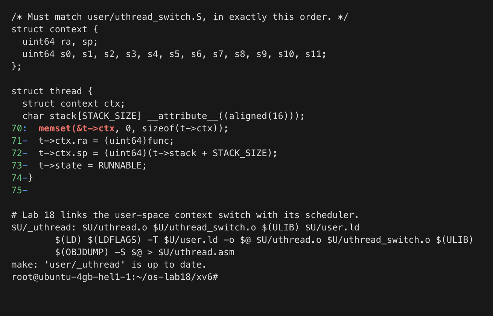
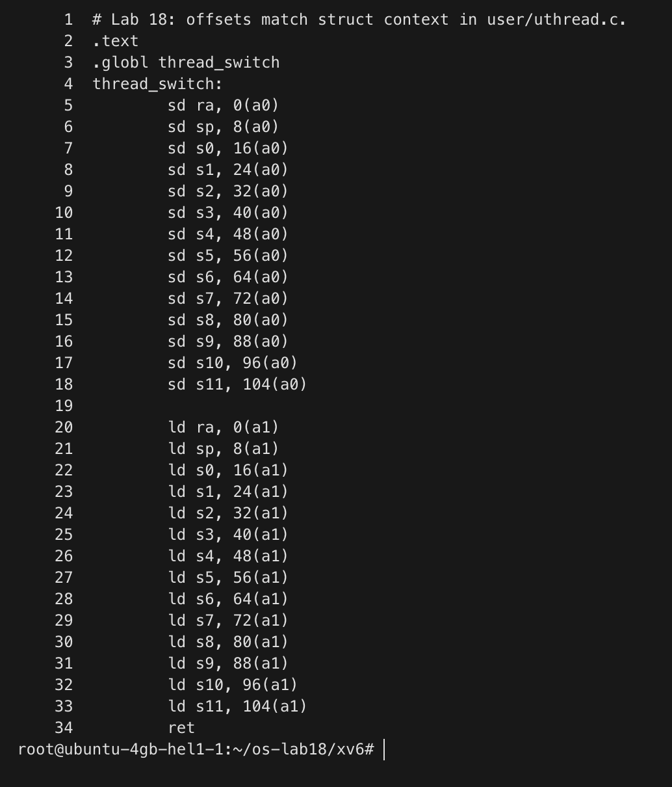

# Lab 18 — A user-level thread switch

Tacu Igor · FAF-242 · Sisteme de operare

## Scope and execution environment

The supplied Lab 18 handout requests completion of `user/uthread.c`, a RISC-V assembly switch in `user/uthread_switch.S`, an explicit Makefile link rule, and the Observe answer in `notes.txt`. All implementation files are submitted in the canonical `xv6/` tree. No kernel source was changed for this laboratory. This is a completed version of the supplied skeleton, adapted only with a check for exhausted thread slots and explicit zeroing of newly created contexts.

The real tree was built and run on the Ubuntu server on 24 November 2026 using the RISC-V cross toolchain and QEMU with three virtual CPUs. The isolated execution copy is `/root/os-lab18/xv6`. The existing Labs 4–13 programs remain registered. The xv6 tree comes from MIT under its included license; the handout supplies the scheduler structure and demonstration, while the context implementation and validation were completed with coding assistance.

`evidence/build.txt` retains the real full-tree build. The build completed; the linker emits the existing RWX LOAD-segment warnings for the kernel and small `forktest` binary. `evidence/execution.txt` contains complete QEMU output for ten runs, and `evidence/results.json` records the checked counts and trace regression. The supplied native Terminal captures show context layout, initial register values, the link rule and the complete assembly switch. Execution screenshots remain to be captured using `CAPTURES.md`; recorded text output below is distinguished from native images.

## Part 1 — Context layout and initial execution

The C context has fourteen eight-byte fields, in the same order used by the assembly routine:

```c
struct context {
  uint64 ra, sp;
  uint64 s0, s1, s2, s3, s4, s5, s6, s7, s8, s9, s10, s11;
};
```

| Register | Offset | Role |
| --- | ---: | --- |
| ra | 0 | Return continuation, or entry function for a new thread |
| sp | 8 | Current stack pointer |
| s0–s11 | 16–104 | Twelve callee-saved integer registers |

Each thread has an 8,192-byte stack aligned to 16 bytes. The stack size is itself a multiple of 16, so its initial top is aligned. Thread creation finds a FREE slot, rejects exhaustion, clears its context, and sets:

```c
memset(&t->ctx, 0, sizeof(t->ctx));
t->ctx.ra = (uint64)func;
t->ctx.sp = (uint64)(t->stack + STACK_SIZE);
t->state = RUNNABLE;
```

On the first selection, the switch loads this synthetic context. Its `ret` enters the function on that thread's stack. On later selections, the same fields contain a real suspended continuation and stack pointer.

The scheduling branch preserves the address of the old thread before changing the global current pointer:

```c
struct thread *old = current_thread;
next_thread->state = RUNNING;
current_thread = next_thread;
thread_switch(&old->ctx, &next_thread->ctx);
```

A yielding worker marks itself RUNNABLE; a finishing worker marks itself FREE. The search starts after the current slot and wraps around, selecting the next runnable context. The main context creates three workers and frees its own slot before giving control to the scheduler. Worker functions explicitly schedule again at their end; this small exercise does not provide a general return trampoline or a join API.

## Assembly switch and build integration

The complete switch mirrors the integer context shape of the existing `kernel/swtch.S`, but executes in user space:

```asm
# Lab 18: offsets match struct context in user/uthread.c.
.text
.globl thread_switch
thread_switch:
        sd ra, 0(a0)
        sd sp, 8(a0)
        sd s0, 16(a0)
        sd s1, 24(a0)
        sd s2, 32(a0)
        sd s3, 40(a0)
        sd s4, 48(a0)
        sd s5, 56(a0)
        sd s6, 64(a0)
        sd s7, 72(a0)
        sd s8, 80(a0)
        sd s9, 88(a0)
        sd s10, 96(a0)
        sd s11, 104(a0)

        ld ra, 0(a1)
        ld sp, 8(a1)
        ld s0, 16(a1)
        ld s1, 24(a1)
        ld s2, 32(a1)
        ld s3, 40(a1)
        ld s4, 48(a1)
        ld s5, 56(a1)
        ld s6, 64(a1)
        ld s7, 72(a1)
        ld s8, 80(a1)
        ld s9, 88(a1)
        ld s10, 96(a1)
        ld s11, 104(a1)
        ret

```

The routine stores the old register set through `a0`, restores the next set through `a1`, then executes `ret`. No system call, address-space change or kernel scheduling operation is required for this user-level switch. All workers share globals in one process while retaining separate stacks and saved callee-saved registers.

The explicit link rule includes both C and assembly objects:

```make
$U/_uthread: $U/uthread.o $U/uthread_switch.o $(ULIB) $U/user.ld
	$(LD) $(LDFLAGS) -T $U/user.ld -o $@ $U/uthread.o $U/uthread_switch.o $(ULIB)
	$(OBJDUMP) -S $@ > $U/uthread.asm
```

`$U/_uthread` is also registered in UPROGS, so `make fs.img` places it in the xv6 filesystem. The required changes are limited to two new user source files and the Makefile.

## Native Terminal evidence — context initialization and link rule



The capture shows `ra`, `sp`, and `s0–s11` in the required order, followed by the thread context and 16-byte-aligned stack declaration. Lines 70–73 clear the saved context, set `ra` to the entry function, set `sp` to the stack top, and mark the slot RUNNABLE. The explicit Makefile rule links both `uthread.o` and `uthread_switch.o` with the user library and linker script.

The final `make` message is `user/_uthread is up to date`: this invocation checks an existing executable rather than showing a fresh compilation. The actual full build and subsequent QEMU runs are retained separately in the evidence logs. This source capture establishes initialization and integration; the assembly capture below documents the register transfer, while native execution captures are still pending.

## Native Terminal evidence — complete assembly switch



The native source capture shows all fourteen stores at lines 5–18: `ra`, `sp`, and `s0–s11` are saved through the old-context pointer in `a0`. Lines 20–33 restore the same registers through the next-context pointer in `a1`, using identical offsets from 0 to 104 in steps of eight bytes. Line 34 executes `ret`, which transfers control through the restored `ra`. The matching store/load layout agrees with the C context shown in the previous capture. This image documents the complete source routine; the recorded QEMU runs and forthcoming execution captures demonstrate its behavior.

## Part 2 — Actual run and validation

The recorded first run begins:

```text
$ uthread
thread_a started
thread_b started
thread_c started
thread_c 0
thread_a 0
thread_b 0
thread_c 1
thread_a 1
thread_b 1
```

After all 300 counter lines, its final round and termination are:

```text
thread_c 99
thread_a 99
thread_b 99
thread_c: exit after 100
thread_a: exit after 100
thread_b: exit after 100
thread_schedule: no runnable threads
```

These are the actual beginning and end excerpts; the omitted middle is retained in full in the execution log. A and B yield while waiting for the other started flags. C sets the last flag, so C prints the first count, followed by A and B. Repeated voluntary yields preserve this round-robin pattern.

`check-lab18.py` verified ten complete runs: each had exactly three start lines, 300 count lines in `c,a,b` rounds from 0 through 99, three exit-after-100 lines and one final scheduler diagnostic. Each run therefore had 307 output lines. Every run matched the entire expected sequence, rather than merely containing a success substring. All ten passed. A subsequent `trace 32 grep hello README` still logged the read system calls, checking the retained Lab 10 functionality.

The final diagnostic is the handout's expected no-runnable case. The process calls `exit(-1)` there after the three workers have finished; the checker requires their complete output before accepting this terminal condition. These are cooperative user threads, not three independently runnable kernel threads. Even with QEMU CPUS=3, one xv6 process executes one of these user contexts at a time.

## Observe — What is saved, and why does ra transfer control?

The switch saves and restores `ra`, `sp`, and all twelve `s` registers at offsets 0 through 104. Under the calling convention the caller already treats argument and temporary registers as call-clobbered, while the `s` registers must survive a call. The saved stack pointer restores the other worker's call frames and local variables. This exercise uses integer contexts and does not implement floating-point thread state.

The call to `thread_switch` places its continuation address in `ra`. When that context is restored, `ret` resumes the suspended scheduler call in that worker. For a newly created thread, the initial `ra` instead names its entry function. Loading the other context's `ra` and executing `ret` therefore transfers execution to that context; there is no separate saved program-counter field in this cooperative call/return design. The same explanation is supplied in the required `notes.txt`.

## Reproduction and captures

Build from `xv6/` with `make kernel/kernel fs.img`, then run `make qemu CPUS=3` and enter `uthread` at the xv6 prompt. To rerun the automated checks from the repository root, use `python3 Lab18/check-lab18.py xv6 /tmp/os-lab18-evidence`. It boots the existing built image and writes real output to the selected directory. Keep a separate generated filesystem image if it contains files you wish to preserve. The screenshot plan covers context initialization, assembly, startup/first rounds and final counts/termination.
